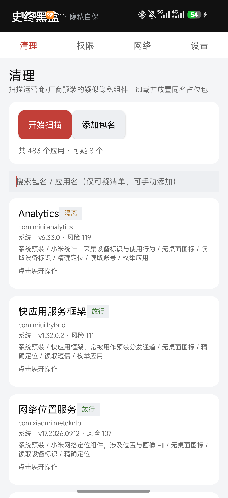
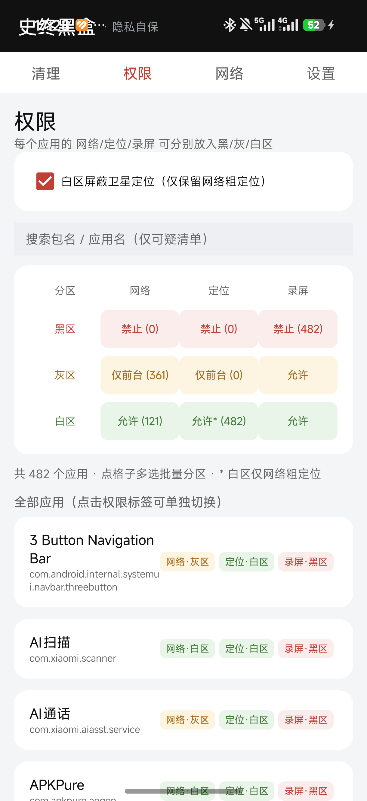
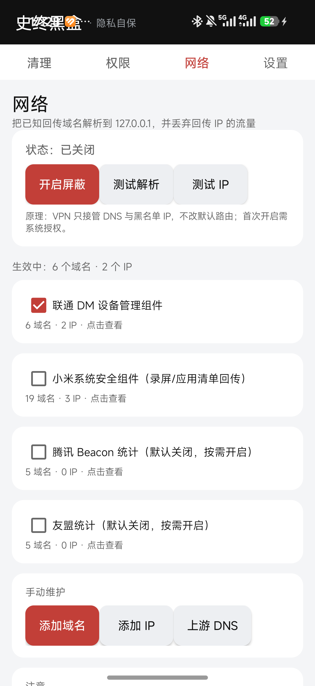
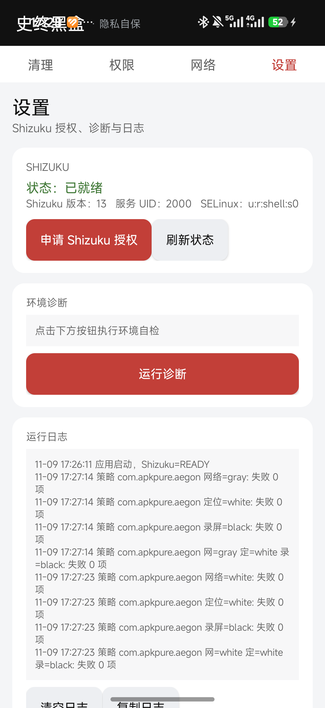

# 史终黑盒 · Shitsend Blackbox

> 一个只依赖 **Shizuku**（运行时无需 Root）的 Android 原生隐私清理与权限管控工具。
> 包名：`mai.solium.shitsendblackbox`

---

## 这是什么

近年大量运营商 / 手机厂商的“系统组件”以 `priv-app` 身份预装，长期存在静默上传通讯录、应用列表、位置、截屏等行为。普通用户既无法卸载（MIUI 拦截 `pm uninstall` 路径），也无法限制其权限（系统应用默认授予全部权限）。

**史终黑盒**做四件事：

| 模块 | 能力 |
|---|---|
| ① 清理 | 只保留已知可疑清单（运营商/厂商预装组件）与手动添加的包名；首页只显示状态（放行 / 隔离 / 顶替 / 已删除），点开才显示操作；**卸载并顶替**（同包名、versionCode 2100000000、apksig v1+v2 异签名空包，阻断 OTA 再生）；**备份原包**，可恢复；顶替失败时**保持删除**（备份保留）；无法卸载时可**隔离**（断网、禁定位、强停、挂起） |
| ② 权限白名单 | 可管理**全体应用**；黑 / 灰 / 白三区 × 网络 / 定位 / 录屏，**每个权限可单独分区**（首次打开全部在绿区/白区）；3×3 矩阵点格子可多选批量分区，带进度条与失败原因，失败自动回退绿区；内置预设「只保留微信 / QQ / 支付宝 / 学习通联网（其余网络灰区）」，支持导入 / 导出预设 JSON；灰区仅前台可用；白区允许联网、定位（卫星定位屏蔽默认关闭）、录屏 |
| ③ 网络封锁 | 选择性屏蔽上传域名/IP：域名 DNS 污染到 `127.0.0.1`，IP 直接丢包；可手动添加；可整体开关；**监控模式**：记录 DNS 查询 + **全隧道模式**下记录 TLS SNI 与应用流量归属，停止后生成分析报告（已知清单 / DoH 与私密 DNS / 疑似统计埋点 / 其他 / 应用流量），可一键把疑似域名加入屏蔽并导出 Markdown 报告 |
| ④ 设置 | Shizuku 申请 / 状态 / 管理；运行诊断；日志查看 |

## 截图

| 清理 | 权限 |
|---|---|
|  |  |
| **网络** | **设置** |
|  |  |

## 工作原理（关键点）

- **卸载**：Shizuku 以 shell（uid 2000）身份执行
  `CLASSPATH=<base.apk> app_process /system/bin mai.solium.shitsendblackbox.cleaner.PackageUninstaller <pkg> 0 <flags>`，
  在目标进程内反射调用 `IPackageManager.deletePackageAsUser(pkg, -1, null, user, flags)`，
  绕过 MIUI 对 `pm uninstall` 命令路径的拦截。普通应用 `flags=0`，系统应用 `flags=5`
  （`DELETE_KEEP_DATA | DELETE_SYSTEM_APP`）。
- **顶替**：删除前把原 APK 备份到应用外部私有目录；随后在运行时**纯代码生成**同包名占位 APK
  （手写 AXML + ZIP，apksig 做 v1+v2 签名，RSA-2048 自签证书，versionCode/versionName=2100000000，
  `enabled=false`、`hasCode=false`、无 launcher 图标），再经 `/data/local/tmp` 交给 `pm install`。
  若 PMS 仍保留原签名墓碑（AOSP 12 / OS4 均实测如此），安装会失败；此时**保持删除状态、不自动恢复**
  （备份保留，可在清理页点「恢复」找回）。`com.xiaomi.metoknlp` 等基础功能组件禁止卸载，只能隔离。
- **隔离**：`appops set ... FINE_LOCATION/COARSE_LOCATION ignore`、`PROJECT_MEDIA deny`、
  `netpolicy add restrict-background-blacklist <uid>`、`am force-stop`、`pm suspend`。
- **网络**：`VpnService` 分流——只把虚拟 DNS（`10.111.222.2`）与黑名单 IP 路由进 TUN，
  不接管默认路由；命中黑名单的 DNS 查询直接应答 `127.0.0.1`/`::1`，其余转发上游 DNS。
- **监控模式**（`network/NetMon.kt`）：VPN 的 DNS 处理路径上旁路记录每次查询（域名、次数、首末时间、
  解析 IP、是否命中屏蔽），按域名标签匹配统计/广告/埋点关键词，停止时生成报告：
  已知清单 / **DoH 与私密 DNS** / 疑似追踪 / 其他（标注来源 DNS 或 TLS SNI）/ **应用流量与 DoH 归属**；
  支持一键加入屏蔽与 SAF 导出 `.md`。
- **全隧道模式（v4，可选）**：`libhev-socks5-tunnel.so`（hev-socks5-tunnel，MIT）+ 应用内 SOCKS5 服务端，
  接管 `0.0.0.0/0` 全部流量，从而看到**不走系统 DNS 的 App**：
  - 每条 TCP 连接读 TLS ClientHello 的 **SNI**，按域名归属到具体 App（`/proc/net/tcp` 反查 uid），并存入
    报告第四段与第五段；
  - SNI 命中屏蔽清单时直接断开连接（App 自带 DoH 也会被掐断，而不只是记录）；
  - 虚拟 DNS `10.111.222.2:53` 走 TCP 解析；`:853`（DoT）明确拒绝，避免递归回环；
  - 本 App 通过 `addDisallowedApplication` 排除在 VPN 外（`protect()` 在部分 ROM 上不可用），
    出站 socket 不会回落到 TUN；
  - **代价**：全部流量经本机转发，耗电/延迟增加；与其它 VPN 互斥；厂商系统可能杀后台，需要「省电无限制 + 自启动」。
  **边界**：只解析 IPv4/IPv6 的 TCP/UDP，无 ICMP；QUIC（UDP 443）按 UDP 直通转发，不做 SNI 解析。
- **权限如何真正生效（v3 修复）**：
  - 普通应用（uid ≥ 10000）后台联网限制用 `cmd netpolicy add restrict-background-blacklist <uid>`，
    **必须逐个 uid 执行**（一次传多个时 Android 只接受第一个，这是旧版“大面积不生效”的根因），
    v3 用一条 shell `for` 循环批量执行；再叠加 `appops RUN_ANY_IN_BACKGROUND invoke ignore` /
    `RUN_IN_BACKGROUND invoke ignore`、`am set-standby-bucket restricted|rare|active`。
  - 系统应用多为共享 uid（`system` 1000 等），netpolicy 直接拒绝（`cannot apply policy to UID 1000`），
    因此对 `uid < 10000` 只做 appops + 冻结，不再记为失败。
  - 黑区网络 = 后台断网 + 禁止后台运行 + 强制停止 + `pm suspend` 冻结；
    无 Root 时**无法阻止应用在前台联网**（系统不开放按应用的前台断网接口），冻结是等价手段。
  - 定位白区会 `pm grant ACCESS_FINE/COARSE_LOCATION` + appops allow（package 与 uid 两级都复位），确保运行时权限真的拿到；预设菜单里的「重设定位权限」可一键修复旧版本遗留的 `ignore`；
    “白区屏蔽卫星定位”默认关闭，且默认不再污染百度定位域名（`loc.map.baidu.com` 等），
    避免签到类应用定位失败。
  - 每条 appops 设置后用 `cmd appops get` 读回校验，未生效即判失败并回退到绿区，页面记录失败原因。
  - 应用卸载后清理页仍会**强制显示** `com.mobiletools.systemhelper`（运营商 OMA-DM 组件），状态显示「已卸载」。

## 技术栈

- **Kotlin**（Android 原生，无 AndroidX、无 Compose、无 Gradle）
- **Shizuku API 13.x**：`IShizukuService.newProcess` 执行 shell，`ShizukuBinderWrapper` 直连系统服务
- **VpnService**：本地 DNS 代理 + 分流路由
- **手动构建**：`kotlinc` + `aapt2` + `d8` + `apksigner`，由 `build.py` 驱动

> 运行时**不使用 Root**。Root 仅用于测试环境注入“模拟泄露”的系统应用。

## 目录结构

```
shitsendblackbox/
├── README.md
├── build.py                     # 一键构建（复用本机 SDK / Kotlin / Shizuku jar）
├── dist/                        # 构建产物 shitsendblackbox-debug.apk
├── docs/
│   ├── 01-需求规格说明书.md
│   ├── 02-技术架构设计.md
│   ├── 03-技术可行性验证报告.md
│   ├── 04-接口与数据结构.md
│   ├── 05-黑名单数据规范.md
│   ├── 06-测试报告.md
│   └── img/                     # 模拟器实机截图
├── app/
│   ├── AndroidManifest.xml
│   ├── assets/blocklist.json    # 内置黑名单种子
│   ├── keystore/blackbox.jks    # 调试签名
│   ├── res/                     # 纯 framework 资源
│   └── src/mai/solium/shitsendblackbox/
│       ├── MainActivity.kt      # 4 个 tab + 页面切换 + Shizuku 回调
│       ├── ui/                  # ScanPage / PermPage / NetPage / SettingsPage + Ui 控件
│       ├── core/                # Shell、ShizukuGate、Logx
│       ├── cleaner/             # Scanner、Cleaner、PackageUninstaller、StubApk、SelfSigned
│       ├── permission/          # PolicyEngine
│       ├── network/             # BlockVpn
│       └── data/                # Stores（备份/分区/黑名单/设置）
```

## 构建

依赖环境（均在 `C:\Users\33558\Documents\deepseek-harness\default-workspace` 下，可由脚本参数覆盖）：

- JDK 21、Python 3
- Android SDK：`out/sdk`（platforms/android-36、build-tools/36.0.0、platform-tools）
- Kotlin 编译器：`out/tools/kotlinc`
- Shizuku jar：`out/shizuku/{api,aidl,provider}-13.1.5-classes.jar`

```bash
python build.py
# 产物：dist/shitsendblackbox-debug.apk
```

脚本流程：`aapt2 compile/link` → `K2JVMCompiler` 编译 Kotlin → `d8`（含 Kotlin stdlib 与 Shizuku）→
组装 `assets/` → `zipalign` → `apksigner --v1 --v2`。

> 注意：本机 `aapt2` 无法写入 Desktop 下目录，构建中间产物固定在 `out/bbbuild`。

## 运行

1. 设备安装 **Shizuku**（Android 11+ 可用无线调试启动），并确保服务已运行
2. 安装本应用，进入「设置」页 → 申请 Shizuku 授权 → 选择“始终允许”
3. 「清理」页扫描 → 搜索可疑项（或点「添加包名」手动加入）→ 点开卡片 → 卸载并顶替 / 隔离 / 恢复；执行时弹出进度与日志
4. 「权限」页可搜索全体应用；点击 3×3 矩阵可多选批量分区；点应用行或权限标签可只改单项权限（网络/定位/录屏各自独立）
5. 「网络」页开启 VPN 总开关（首次需系统 VPN 授权），可用“测试解析”验证污染、“测试 IP”验证丢包

## 已知限制

- **AOSP 12（及部分 ROM）**：`deletePackageAsUser(DELETE_SYSTEM_APP)` 后 PMS 会保留签名墓碑，
  异签名占位包安装报 `INSTALL_FAILED_UPDATE_INCOMPATIBLE`；应用会自动恢复并降级为隔离。
  该路径在 Android 17 / OS4 上可能已放行，需真机复验。
- **DoH/DoT、硬编码 IP** 可绕过 DNS 污染，需在“添加 IP”中补充。
- 隔离对系统关键包可能无效，请勿对拨号、系统界面等关键包操作。
- 清除本应用数据会丢失备份与配置。

## 声明

- 本工具会**修改系统应用状态**，可能导致系统功能异常、OTA 失败、数据丢失。请先阅读
  [技术可行性验证报告](docs/03-技术可行性验证报告.md)。
- 请仅在你**拥有或获授权管理**的设备上使用。使用者需自行承担合规与法律责任。
- 本项目不提供、不内置任何破解、提权或绕过设备所有者策略的能力。

## 文档

- [需求规格说明书](docs/01-需求规格说明书.md)
- [技术架构设计](docs/02-技术架构设计.md)
- [技术可行性验证报告](docs/03-技术可行性验证报告.md)
- [接口与数据结构](docs/04-接口与数据结构.md)
- [黑名单数据规范](docs/05-黑名单数据规范.md)
- [测试报告](docs/06-测试报告.md)

## 许可证

仅供学习与研究使用。详见文档中的免责声明。
